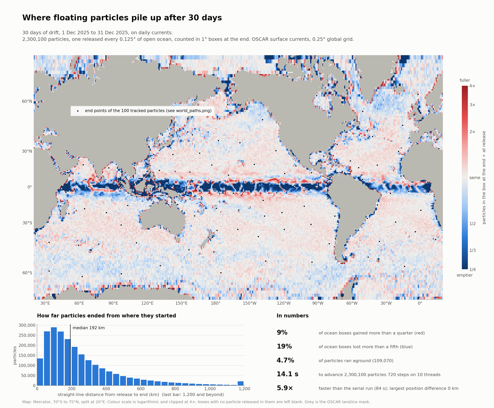
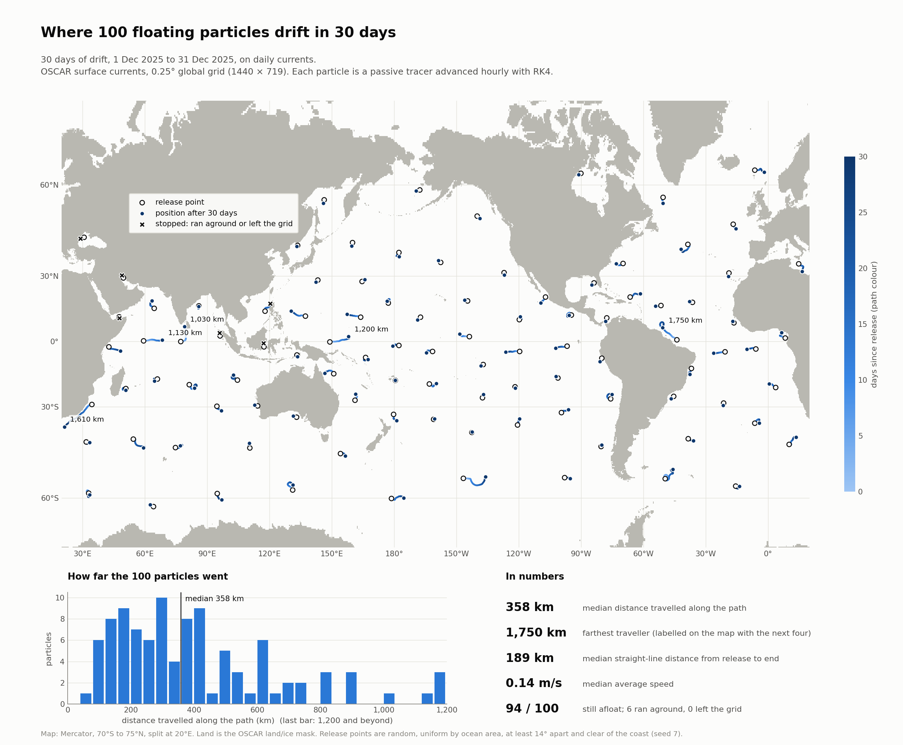
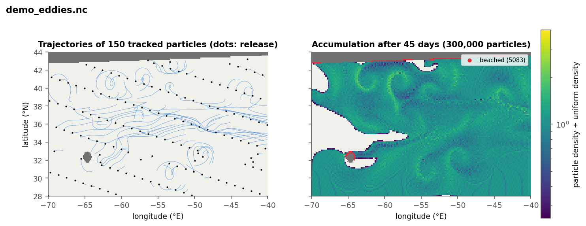
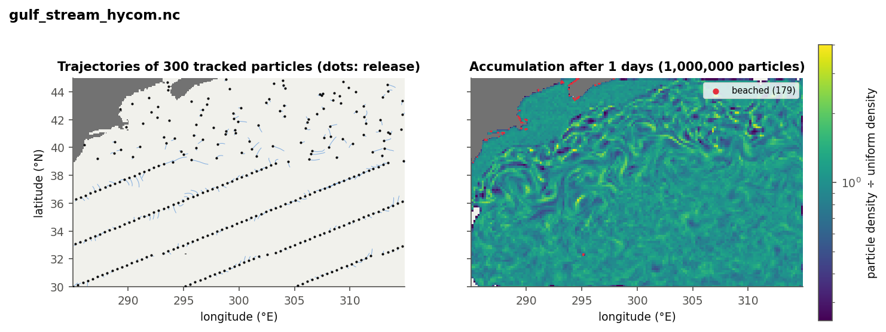
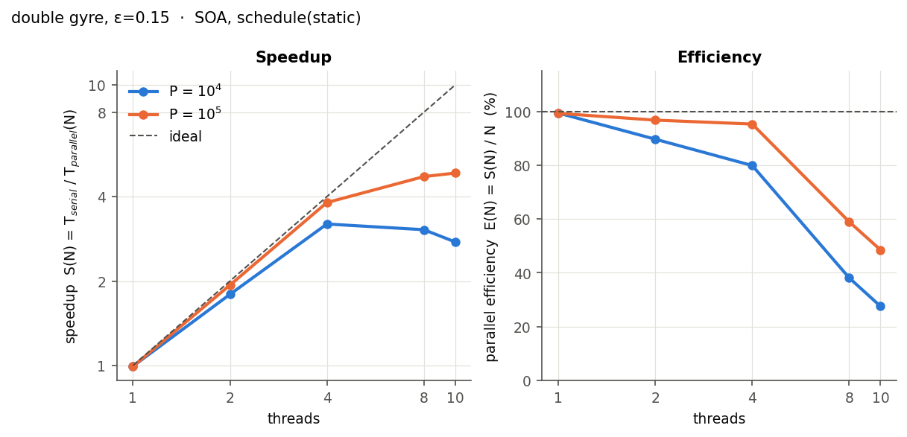
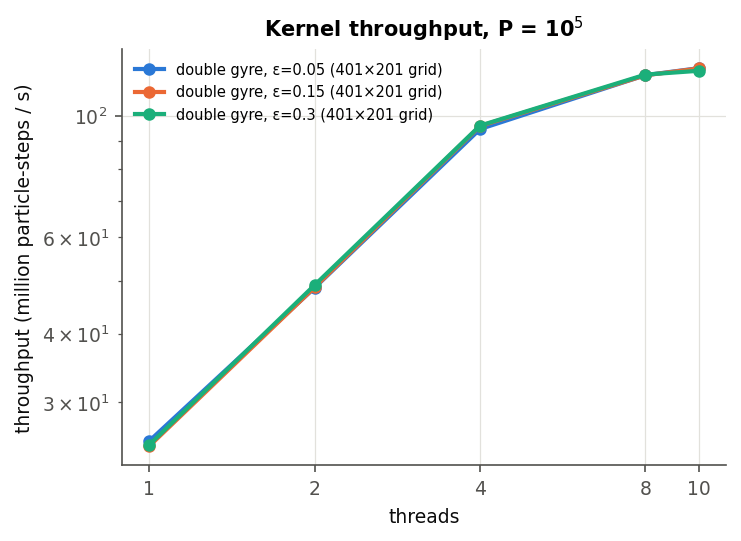
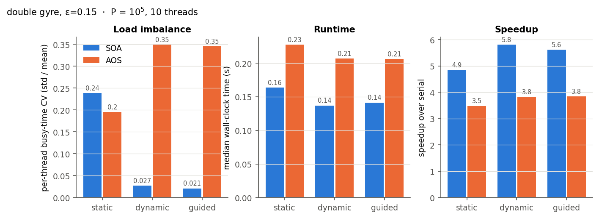
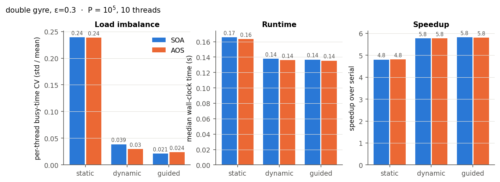

# Parallel Simulation of Microplastic Dispersion Using Ocean Current Data

[](https://en.wikipedia.org/wiki/C%2B%2B17)
[](https://www.openmp.org/)
[]()
[]()
[]()
[]()

A high-performance OpenMP-parallel C++17 Lagrangian particle-advection framework for modeling oceanic microplastic dispersion using satellite-derived ocean surface currents (NASA PO.DAAC OSCAR and NOAA/NCEP HYCOM) and canonical analytic flow benchmarks.

---

## Table of Contents

- [Overview](#overview)
- [Key Results & Visualizations](#key-results--visualizations)
  - [Global Ocean Simulation & Gyre Convergence](#global-ocean-simulation--gyre-convergence)
  - [Regional Eddy Dispersion](#regional-eddy-dispersion)
  - [Parallel Scaling & Performance Analysis (RQ1–RQ4)](#parallel-scaling--performance-analysis-rq1rq4)
- [Methodology & Mathematics](#methodology--mathematics)
  - [Lagrangian Advection Formulation](#lagrangian-advection-formulation)
  - [Trilinear Spatio-Temporal Interpolation](#trilinear-spatio-temporal-interpolation)
  - [4th-Order Runge-Kutta (RK4)](#4th-order-runge-kutta-rk4)
  - [Analytic Double Gyre Benchmark](#analytic-double-gyre-benchmark)
  - [Boundary & Beaching Dynamics](#boundary--beaching-dynamics)
- [Performance Benchmarks](#performance-benchmarks)
- [Project Layout](#project-layout)
- [Build & Dependencies](#build--dependencies)
- [Quick Start & Demo Runs](#quick-start--demo-runs)
- [Real Ocean Data Pipeline](#real-ocean-data-pipeline)
- [Methodology Reports & Presentations](#methodology-reports--presentations)

---

## Overview

Marine microplastic accumulation in subtropical oceanic gyres ("garbage patches") is driven by mesoscale eddies and large-scale geostrophic surface currents. Simulating millions of passive tracer particles over multi-month to multi-year horizons demands high computational throughput and numerical precision.

This repository implements a lightweight, zero-dependency parallel simulation engine in C++17:
- **Massively Parallel Advection:** OpenMP multi-threading with dynamic, static, and guided worksharing schedules.
- **Zero-Dependency NetCDF Reader:** Built-in hand-crafted binary reader for classic NetCDF (CDF-1, CDF-2, and CDF-5) files without requiring external NetCDF-C/HDF5 libraries.
- **Data Layout Exploration:** Direct comparative study between Structure of Arrays (SoA) and Array of Structures (AoS) for memory hierarchy efficiency.
- **Physical Fidelity & Ground-Truth Verification:** Analytical streamfunction conservation checks and error validation against high-resolution reference solutions.

---

## Key Results & Visualizations

### Global Ocean Simulation & Gyre Convergence

Using 30-day and 6-month satellite-derived ocean velocity fields from **NASA OSCAR** (0.25° daily global resolution, 1440 × 719 grid), particles advect across major ocean currents and converge into global gyre accumulation zones:

| Global Accumulation Heatmap (2.3M Particles) | 30-Day Global Trajectories (100 Tracked Particles) |
| :---: | :---: |
|  |  |
| *High-density advection demonstrating tracer convergence into subtropical gyres (North Pacific Garbage Patch, South Atlantic, Indian Ocean).* | *Trajectories of ocean tracers color-coded by elapsed time, capturing western boundary currents (Gulf Stream, Kuroshio).* |

---

### Regional Eddy Dispersion

Simulations on regional domains capture realistic mesoscale filamentation and coastal entrapment:

| Synthetic Mesoscale Eddy Field (Demo) | NOAA HYCOM Gulf Stream Dispersion |
| :---: | :---: |
|  |  |
| *1,000,000 particles advected in `data/demo_eddies.nc` showing turbulent mixing.* | *Particle advection along the energetic Gulf Stream current boundary.* |

---

### Parallel Scaling & Performance Analysis (RQ1–RQ4)

Comprehensive benchmarks evaluating strong scaling, memory bottlenecks, and scheduling overhead:

| Strong Scaling & Efficiency (RQ1) | Memory & Compute Bound Roofline (RQ2) |
| :---: | :---: |
|  |  |
| *Speedup and parallel efficiency across 1 to 10 threads for $P \in \{10^4, 10^5\}$ particles.* | *Particle-step throughput across grid resolutions; cache-fitting vs DRAM bandwidth behavior.* |

| Scheduling Policy & Data Layout (RQ3, $\varepsilon = 0.15$) | Scheduling Policy & Data Layout (RQ3, $\varepsilon = 0.30$) |
| :---: | :---: |
|  |  |
| *Static vs Dynamic vs Guided scheduling and SoA vs AoS memory layouts.* | *High-chaotic mixing regime ($\varepsilon=0.30$) workload distribution and load balance.* |

---

## Methodology & Mathematics

### Lagrangian Advection Formulation

Each particle is modeled as an infinitesimal passive tracer whose trajectory $\vec{x}(t) = (\lambda(t), \phi(t))$ satisfies:

$$\frac{d\vec{x}}{dt} = \vec{u}(\vec{x}, t)$$

On a spherical Earth with radius $R = 6371\text{ km}$, velocities $(u, v)$ in $\text{m/s}$ are converted to angular rates:

$$\frac{d\lambda}{dt} = \frac{u(\lambda, \phi, t)}{R \cos\phi}, \qquad \frac{d\phi}{dt} = \frac{v(\lambda, \phi, t)}{R}$$

### Trilinear Spatio-Temporal Interpolation

At any arbitrary continuous point $(\lambda, \phi, t)$, velocity is evaluated using spatial bilinear interpolation over the four bounding grid cells, followed by linear interpolation between the two bracketing temporal velocity slices $t_0 \le t \le t_1$.

### 4th-Order Runge-Kutta (RK4)

Trajectories are updated via fixed-step 4th-order Runge-Kutta:

$$\begin{aligned}
k_1 &= \vec{u}(\vec{x}_n, t_n) \\
k_2 &= \vec{u}\left(\vec{x}_n + \frac{\Delta t}{2} k_1, t_n + \frac{\Delta t}{2}\right) \\
k_3 &= \vec{u}\left(\vec{x}_n + \frac{\Delta t}{2} k_2, t_n + \frac{\Delta t}{2}\right) \\
k_4 &= \vec{u}(\vec{x}_n + \Delta t k_3, t_n + \Delta t) \\
\vec{x}_{n+1} &= \vec{x}_n + \frac{\Delta t}{6}(k_1 + 2k_2 + 2k_3 + k_4)
\end{aligned}$$

Numerical tests confirm $O(\Delta t^4)$ convergence: error decreases by a factor of $16.0\times$ when halving the timestep.

### Analytic Double Gyre Benchmark

To assess physical fidelity against ground truth without interpolation noise, the engine incorporates the time-periodic double gyre flow (Shadden et al., 2005):

$$\psi(x, y, t) = A \sin(\pi f(x, t)) \sin(\pi y)$$

$$f(x, t) = a(t) x^2 + b(t) x, \quad a(t) = \varepsilon \sin(\omega t), \quad b(t) = 1 - 2\varepsilon \sin(\omega t)$$

$$u = -\frac{\partial \psi}{\partial y} = -\pi A \sin(\pi f(x, t)) \cos(\pi y)$$

$$v = \frac{\partial \psi}{\partial x} = \pi A \cos(\pi f(x, t)) \sin(\pi y) \frac{df}{dx}$$

- When $\varepsilon = 0$, the flow is steady and Hamiltonian; streamfunction $\psi$ is conserved along streamlines to machine precision ($< 1.4 \times 10^{-9}$).
- When $\varepsilon > 0$, periodic perturbation induces chaotic transport and cross-gyre mixing across the oscillating separatrix.

### Boundary & Beaching Dynamics

- **Land Masking:** Grid cells with missing values or flagged as land cause particles entering them to freeze at their last valid coordinates (representing plastic stranding on coastlines).
- **Domain Exit:** Particles advected outside open ocean boundaries are frozen and flagged as `EXITED`.
- **Zero Parallel Drift:** The parallel OpenMP kernel produces bitwise or zero-drift results against the serial baseline (`drift_max = 0`, `state_mismatch = 0`).

---

## Performance Benchmarks

Sample metrics collected on an Apple Silicon multi-core processor (from `results/bench.csv`):

| Particles | Threads | Schedule | Layout | Median Time (s) | Throughput (steps/s) | Speedup |
| :---: | :---: | :---: | :---: | :---: | :---: | :---: |
| 100,000 | 1 (Serial) | — | SoA | 0.781 s | $2.56 \times 10^7$ | 1.00× |
| 100,000 | 2 | Guided | SoA | 0.409 s | $4.88 \times 10^7$ | 1.91× |
| 100,000 | 4 | Guided | SoA | 0.214 s | $9.32 \times 10^7$ | 3.65× |
| 100,000 | 8 | Guided | SoA | 0.149 s | $1.34 \times 10^8$ | 5.24× |
| 100,000 | 10 | Guided | SoA | 0.138 s | $1.45 \times 10^8$ | **5.66×** |

Key research findings:
- **RQ1 (Scaling):** Near-linear speedup up to the physical core count, achieving over **145 million particle-evaluations per second**.
- **RQ2 (Roofline):** Double gyre flow is compute-bound ($AI \approx 9.24\text{ FLOP/byte}$), fully saturating vector execution units. Large NetCDF fields shift toward memory-bandwidth limitations as grid size exceeds cache capacities.
- **RQ3 (Scheduling & Layout):** `guided` and `dynamic` scheduling mitigate thread idle time when particle beaching creates non-uniform workload per loop iteration. SoA improves SIMD vectorization and cache utilization over AoS.
- **RQ4 (Fidelity):** Mean ground truth error remains below $1.4 \times 10^{-3}$ domain units with zero discrepancy between serial and OpenMP trajectories.

---

## Project Layout

```text
.
├── include/mpd/
│   ├── advect.hpp          # RK4 kernel, serial loop, OpenMP worksharing (Algorithm 1)
│   ├── field.hpp           # 2D/3D velocity grid, double gyre generator, interpolation
│   ├── netcdf.hpp          # Native zero-dependency classic NetCDF binary reader
│   ├── particles.hpp        # SoA & AoS particle arrays and release initializers
│   └── types.hpp            # Constants, geodetic conversions, ParticleState enum
├── src/
│   ├── main.cpp            # CLI driver: warmup, benchmarking, CSV & numpy output
│   ├── field.cpp           # Velocity grid storage, sampling, coordinate transforms
│   └── netcdf.cpp          # Low-level CDF-1/2/5 binary parsing implementation
├── tools/
│   └── roofline.cpp        # STREAM triad bandwidth & peak FLOP benchmark
├── tests/
│   └── test_main.cpp       # 346 automated tests (RK4 order, conservation, NetCDF)
├── scripts/
│   ├── plot_results.py     # Generates scaling curves, maps, and figures
│   ├── run_sweep.py        # Automated benchmark parameter sweep
│   ├── world_drift.py      # End-to-end global OSCAR simulation & Mercator plotting
│   ├── prep_currents.py    # Subsetting & NetCDF-4 to classic conversion
│   ├── fetch_oscar.sh      # Automated NASA PO.DAAC daily OSCAR retrieval
│   ├── fetch_hycom.sh      # Automated NOAA/NCEP HYCOM surface current download
│   └── make_test_nc.py     # Synthetic test NetCDFs generator
├── data/
│   ├── demo_eddies.nc      # Synthetic eddy field (ready to run out-of-the-box)
│   └── gulf_stream_hycom.nc# Real ocean current sample (HYCOM subset)
├── results/
│   ├── bench.csv           # Full experimental benchmark results
│   ├── roofline.csv        # Hardware arithmetic intensity and bandwidth limits
│   ├── figs/               # Publication-ready scaling and regional dispersion plots
│   └── world/              # Global 30-day and 6-month simulation plots
├── Makefile                # Multi-platform build system (macOS / Linux)
├── biju_methodology.pdf    # Project methodology report
├── microplastic intro.pdf  # Physical introduction to microplastic dispersion
└── README.md
```

---

## Build & Dependencies

### Prerequisites

- **C++ Compiler:** Modern C++17 compliant compiler (`g++` >= 9 or `clang++` >= 10).
- **OpenMP Runtime:**
  - *Linux:* Included with GCC (`-fopenmp`).
  - *macOS:* Apple Clang does not ship with `libomp` by default. The Makefile automatically searches `third_party/libomp`, Homebrew (`/opt/homebrew/opt/libomp`), or MacPorts.
- **Python (for plotting & data prep):** `python3` with `numpy`, `matplotlib`, and optionally `netCDF4`.

### Building

```bash
# Clean and build simulation binary (build/mpd) and roofline tool (build/roofline)
make -j4

# Run the automated test suite (346 checks)
make test
```

To build in serial mode without OpenMP:
```bash
make OPENMP=0
```

---

## Quick Start & Demo Runs

### 1. Analytic Double Gyre Simulation

Run both serial and OpenMP parallel advection on a $401 \times 201$ double gyre with 100,000 particles and analytical ground-truth validation:

```bash
./build/mpd --field dg --eps 0.15 --particles 100000 --threads 4 --schedule static --truth
```

### 2. Mesoscale Eddy Dispersion (Demo Data)

Advect 1,000,000 particles through the synthetic eddy field for 30 simulation days and plot the resulting dispersion map:

```bash
# Generate synthetic demo NetCDF (if not already present)
make data

# 1. Run parallel simulation
./build/mpd --field nc --file data/demo_eddies.nc --particles 1000000 --duration 30 --threads 8 --out results/demo

# 2. Render trajectory and accumulation map
python3 scripts/plot_results.py map results/demo --png results/demo_map.png
```

### 3. Real Ocean HYCOM Current Run

```bash
./build/mpd --field nc --file data/gulf_stream_hycom.nc --particles 500000 --duration 10 --threads 8 --out results/gulf
python3 scripts/plot_results.py map results/gulf --png results/figs/gulf_stream_1day_map.png
```

### 4. Reproducing Performance Scaling Plots

Regenerate all scaling figures directly from the benchmark dataset:

```bash
python3 scripts/plot_results.py scaling results/bench.csv --outdir results/figs
```

---

## Real Ocean Data Pipeline

The C++ engine uses a high-performance native parser for classic NetCDF files (CDF-1, CDF-2, and CDF-5). Satellite and reanalysis current datasets distributed in NetCDF-4/HDF5 format can be preprocessed with the included utilities:

### NASA OSCAR (Global 0.25° Daily Surface Currents)
1. Register for a free NASA Earthdata account at [urs.earthdata.nasa.gov](https://urs.earthdata.nasa.gov).
2. Store your credentials:
   ```bash
   bash scripts/earthdata_login.sh
   ```
3. Fetch a global multi-day dataset:
   ```bash
   bash scripts/fetch_oscar.sh 2025-12-01 31
   ```
4. Run global advection and generate Mercator world maps:
   ```bash
   python3 scripts/world_drift.py --field data/oscar_global_2025-12-01_31d.nc
   ```

### NOAA HYCOM (High-Resolution 0.08° Ocean Slices)
```bash
# Fetch and preprocess Gulf Stream regional slice
bash scripts/fetch_hycom.sh gulf_stream
```

---

## Methodology Reports & Presentations

The detailed mathematical formulation, physical modeling assumptions, and parallel computing methodology are documented in the attached project presentations and reports:
- [Methodology Report (PDF)](biju_methodology.pdf)
- [Microplastic Dispersion Intro (PDF)](<microplastic intro.pdf>)
- [Presentation: Microplastic Dispersion Intro (PPTX)](Microplastic_Dispersion_Intro.pptx)
- [Presentation: Methodology & OSCAR Validation (PPTX)](Microplastic_Dispersion_Methodology_OSCAR_v2.pptx)

---

## Academic Context

Developed for **IT301 Parallel Computing**, Department of Information Technology, **National Institute of Technology Karnataka (NITK), Surathkal**.
